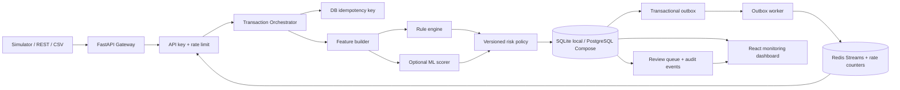

# Architecture

## Deployment shape

Start as a modular monolith: one FastAPI process with clear module boundaries, PostgreSQL for durable records, Redis for shared rate-limit counters and Streams, an outbox publisher worker, and a React dashboard. Local development defaults to SQLite so the API can run before Docker is installed. The Docker Compose profile uses PostgreSQL and Redis.

## Component responsibilities

- **API gateway:** schema validation, versioned routes, API-key checks, rate limits, and health endpoints. Local development bypasses API-key checks; other environments require `API_KEY`.
- **Transaction orchestrator:** coordinates idempotency, feature calculation, rules, optional model scoring, decision policy, persistence, and review-queue creation.
- **Feature builder:** builds the model feature vector from normalized amount and server-observed history. Callers cannot submit derived risk features.
- **Rule engine:** deterministic checks with named reason codes. The initial rules flag high USD amounts and 10-minute customer/instrument velocity.
- **ML scorer:** loads an optional trusted, versioned joblib artifact and returns a fraud probability. With no configured artifact, the score is `null` and the decision uses rules only.
- **Risk policy:** combines rule points with up to 60 model points into a 0–100 score; applies configurable approve/review/decline thresholds.
- **Database:** stores the transaction, request hash, decision result, model/policy versions, append-only manual review events, and durable unpublished outbox events. Idempotency keys have a database uniqueness constraint.
- **Redis:** stores short-lived fixed-window request counters and receives outbox events in a Redis Stream. Velocity currently uses indexed database history so its behavior is durable and simple to inspect.
- **Dashboard:** polls summaries and transactions every five seconds, shows pending reviews, and records approve/decline review outcomes. In local development it uses a static `local-development` actor; production should derive actor identity from an authenticated user provider.

## Transaction decision flow

1. Validate a USD transaction with an idempotency key and a timezone-aware event timestamp. PAN, CVV, bank credentials, and payment secrets are not accepted.
2. Look up the idempotency key. A retry with an identical request gets the saved decision; reusing the key with a changed request returns `409`.
3. Count recent customer and instrument transactions using server receipt time, not caller-controlled event time, to reduce timestamp-based velocity evasion.
4. Apply named rules and, if a trusted artifact is configured, score the fixed feature set.
5. Combine rule points and model probability. Defaults are 0–29 approve, 30–69 review, 70–100 decline; they are demonstration values, not calibrated operating thresholds.
6. Persist the request-safe transaction, decision, and an outbox event for review/decline outcomes in one database transaction.
7. The worker publishes outbox rows to a Redis Stream with at-least-once delivery; consumers should deduplicate by event ID. A reviewer can resolve a pending item once, with its state change, review audit event, and outbox event committed together.

## Data and safety boundaries

- The first decision policy accepts USD only. Additional currencies require a trusted FX normalization policy before amount thresholds or model features can be compared.
- Customer, instrument, and merchant values are opaque demo tokens. Define tokenization, retention, access, and deletion policies before using production identifiers.
- A risk score and model probability are signals. Neither establishes that a person committed fraud.
- Keep model, rule, and policy versions with every decision. Load model artifacts only from trusted sources.
- The included training data is synthetic. Its metrics demonstrate workflow mechanics only; they are not an estimate of real-world performance.

## Persistent records

- `TransactionRecord`: normalized transaction attributes, idempotency hash, score, action, reasons, model/policy versions, and review status.
- `ReviewEvent`: append-only review outcome, actor label, note, and timestamp.
- `OutboxEvent`: unpublished event payload and retry metadata, committed with the transaction or review result.

## Production additions

Before deployment, add an authenticated identity provider for reviewers, secret management, database backup/retention policy, structured audit logging, a consumer for alert delivery, model monitoring and rollback controls, dataset governance, load testing, and calibrated thresholds. The Docker Compose configuration is for local development and uses local-only credentials.
